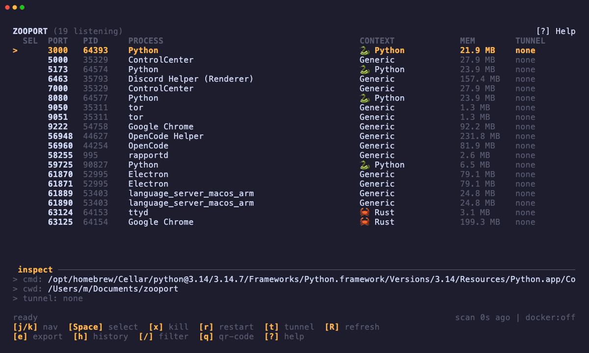
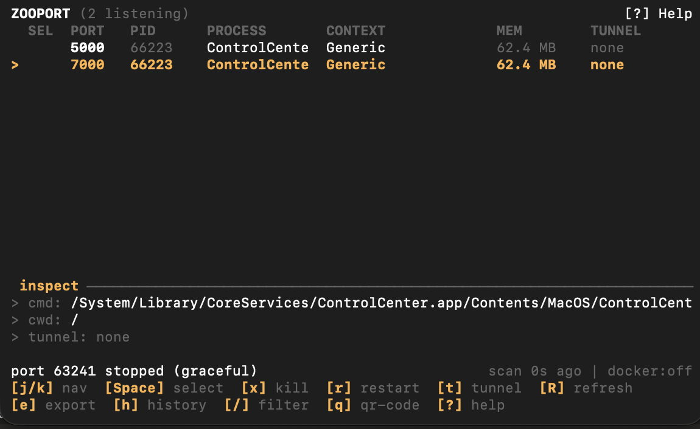

<div align="center">

<h1>zooport</h1>

A terminal UI for the ports on your machine.

[](https://github.com/sprensis/zooport/actions/workflows/ci.yml)
[](LICENSE)
[](https://www.rust-lang.org)
[](#platforms)

</div>

<p align="center">
  
</p>

`zooport` lists every listening TCP socket, shows the process behind it, and lets you filter, kill, restart, export, or tunnel it without leaving the terminal. It's one Rust binary. No daemon, no browser, no required config.

```text
 ZOOPORT (3 listening)                                       [?] Help
 SEL  PORT  PID     PROCESS        CONTEXT          MEM       TUNNEL
  ●   3000  4812    node           🐱 Node          82.4 MB   active
      5432  921     postgres       Generic          64.1 MB   none
      8080  5120    docker-proxy   🐳 my-api        12.8 MB   none
```

## What's in it

- **Ports, with context.** PID, process name, runtime, memory, command line, cwd, and transport. Runtime detection is based on the executable, process name, command line, and project files. If it can't tell, it says `Generic`.
- **Animal badges.** 🐳 Docker, 🦭 Podman, 🦀 Rust, 🦫 Go, 🐍 Python, 🐱 Node. Docker containers show the container name when `docker` is available.
- **Bulk actions.** `Space` marks rows. `x` and `r` then apply to everything marked, or to the selected row if nothing is marked.
- **Live filters.** `/` filters by port, PID, process, command line, or cwd. Prefix with `docker:`, `podman:`, `rust:`, `go:`, `python:`, `node:`, or `generic:` to narrow by runtime.
- **Cloudflare quick tunnels.** `t` starts `cloudflared tunnel --url http://127.0.0.1:<port>`, grabs the `trycloudflare.com` URL from stderr, and copies it to your clipboard.
- **QR codes in the terminal.** `q` renders the active tunnel URL as a half-block QR code. No image protocol needed.
- **Tunnel history.** `h` opens a session history with status, start time, duration, and URL.
- **Markdown export.** `e` copies the filtered table to the clipboard as Markdown.
- **`zooport.toml`.** Change the accent color and hide ports or processes you don't care about.
- **Careful process control.** Before acting on a PID, zooport checks that it still owns the socket. Kill asks the process to stop, waits, then force-kills it if needed. Restart captures argv, cwd, and environment before killing, then spawns the new process detached with null stdio.
- **No shared state.** The scanner, lifecycle actions, tunnel manager, and clipboard all run off the render loop and talk to the UI through owned channel messages.

## Screenshot

<p align="center">
  
</p>

## Install

### Cargo

```bash
# After the first crates.io release
cargo install zooport

# Or straight from GitHub
cargo install --git https://github.com/sprensis/zooport.git
```

### From source

```bash
git clone https://github.com/sprensis/zooport.git
cd zooport
cargo build --release
./target/release/zooport
```

You need a stable Rust toolchain. `cloudflared` is only needed for tunnels.

### Homebrew

There's no formula in this repo yet. If you publish a tap, the release workflow gives you archives named `zooport-<target>.tar.gz` (`.zip` on Windows). A formula can download the matching archive, verify the published SHA-256 checksum, and install the binary.

```bash
brew tap sprensis/tap
brew install zooport
```

The commands above only work after you create `sprensis/homebrew-tap` and add `Formula/zooport.rb`.

## Usage

Run `zooport`. Press `?` for help, `/` to filter, `t` to tunnel the selected port, and `q` to quit from the main view. `Esc` clears a filter; on an empty screen it quits. `Ctrl-C` always quits.

### Keys

| Key | Action |
| --- | --- |
| `j` / `↓` | Move down |
| `k` / `↑` | Move up |
| `g` / `Home` | First port |
| `G` / `End` | Last port |
| `Space` | Mark / unmark |
| `x` | Kill marked ports, or the selected port |
| `r` | Restart marked ports, or the selected port |
| `t` | Start / stop a quick tunnel |
| `q` | Show QR for the selected active tunnel |
| `e` | Copy filtered rows as Markdown |
| `h` | Open tunnel history |
| `c` | Clear history (inside the history modal) |
| `/` | Filter |
| `Enter` | Apply filter and return to navigation |
| `Esc` | Clear filter / close the current modal |
| `R` / `F5` | Refresh now |
| `?` | Help |
| `Ctrl-C` | Quit from any mode |

`x` and `r` block while a batch is running. You can't queue a second lifecycle action.

### Filters

Filters are case-insensitive and match the port, PID, process name, runtime context, command line, and working directory.

```text
3000          any row containing "3000"
python        any row containing "python"
docker:       rows detected as Docker
podman:       rows detected as Podman
rust:         rows detected as Rust
go:           rows detected as Go
python: api   Python rows that also contain "api"
node: 5173    Node rows that also contain "5173"
```

Runtime prefixes: `docker:`, `podman:`, `rust:`, `go:`, `python:`, `node:` / `nodejs:`, `generic:`.

## Tunnels

Select a port and press `t`. zooport starts a Cloudflare quick tunnel and copies the public URL to your clipboard. Press `q` for a QR code, or `t` again to stop it.

Install `cloudflared` if you don't have it:

```bash
brew install cloudflared                  # macOS
winget install --id Cloudflare.cloudflared # Windows
```

On Debian/Ubuntu, follow Cloudflare's current repository instructions rather than using an old package.

Quick tunnels are public and have no authentication. Don't expose anything sensitive. If you need access control or a stable hostname, use a named Cloudflare Tunnel instead.

If the clipboard isn't available, the tunnel still works and the URL stays visible in the UI.

## Config

`zooport.toml` is optional:

```toml
# Hex (#RRGGBB or 0xRRGGBB) or a named terminal color.
accent = "#FFB347"

# Hide these ports completely.
ignored_ports = [5432, 9229]

# Case-insensitive process names to hide.
ignored_processes = ["Spotlight", "mDNSResponder"]
```

zooport uses the first file it finds. In each directory, `zooport.toml` wins over the legacy `config.toml`.

1. `$ZOOPORT_CONFIG`
2. `./zooport.toml`
3. `%APPDATA%\zooport\` (Windows)
4. `$XDG_CONFIG_HOME/zooport/`
5. `$HOME/.config/zooport/`

Invalid config falls back to defaults. It won't stop the TUI from starting.

## Platforms

| Platform | Status |
| --- | --- |
| macOS Intel / Apple Silicon | Supported |
| Linux x86_64 / ARM64 | Supported |
| Windows x86_64 | Supported |

Clipboard access depends on the desktop session. Everything else uses native process and socket APIs.

## Recording the demo

The included [`demo.tape`](demo.tape) records a short run: it starts three Python HTTP servers, launches zooport, navigates, filters, marks a couple of rows, opens a tunnel, and shows the QR code.

Install VHS and cloudflared, build the release binary, then record:

```bash
brew install vhs cloudflared
cargo build --release
vhs demo.tape
```

VHS needs `ttyd` and `ffmpeg`; the Homebrew package pulls both in. On Linux, `go install github.com/charmbracelet/vhs@latest` and install `ttyd` and `ffmpeg` with your package manager. The tape writes `demo.gif` to the repo root. It waits for the tunnel to become active before pressing `q`, so a slow network won't break the recording.

If a recording is interrupted, kill the demo servers before retrying:

```bash
pkill -f "http.server 3000"
pkill -f "http.server 5173"
pkill -f "http.server 8080"
```

The tape is intentionally simple. Tune `Set FontSize`, `Set Width`, `Set Height`, `Sleep`, `Wait+Screen`, and `Set PlaybackSpeed` at the top of the file if you want different pacing or dimensions.

## How it fits together

```text
scanner task ────────┐
lifecycle tasks ─────┤
tunnel manager ──────┤──> event loop (owns App and the terminal)
clipboard thread ────┘
```

- The event loop owns `App`. Nothing else touches it.
- The scanner returns an owned `ScanSnapshot`; it never lends `sysinfo::System` or kernel state to the UI.
- Kill/restart work runs in short-lived Tokio tasks with cloned `PortEntry` values, so a slow `SIGTERM` can't block rendering.
- Each `cloudflared` child is owned by a tunnel worker. The manager ignores events from replaced tunnels by generation ID.
- Shutdown stops tunnels and reaps children before the terminal is restored.

The module docs in `src/` go into the ownership boundaries in more detail.

## Development

```bash
cargo fmt --all -- --check
cargo clippy --all-targets --all-features -- -D warnings
cargo test --all-targets --all-features
cargo run
```

CI runs fmt and Clippy on Linux and tests on Linux, macOS, and Windows. A version tag like `v0.1.0` builds release archives for Linux x64/ARM64, macOS Intel/Apple Silicon, and Windows x64, with SHA-256 checksums.

## License

MIT. See [LICENSE](LICENSE).
